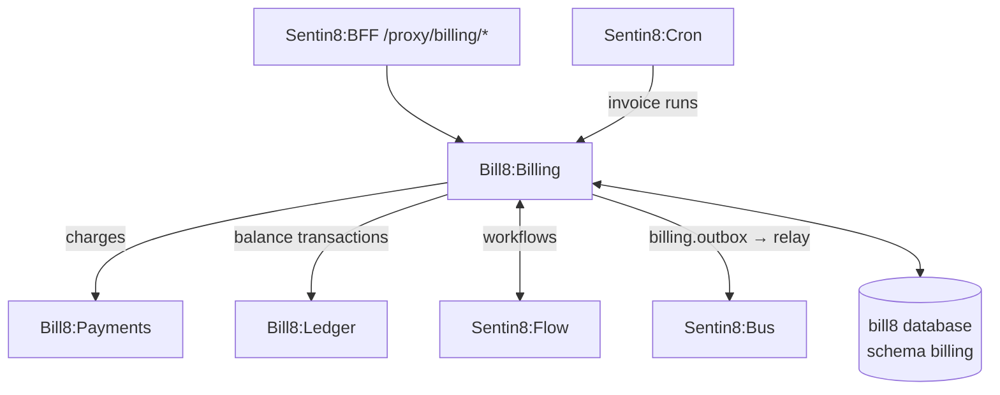

# Bill8:Billing - Recurring Billing

Products, prices, subscriptions, invoices, usage records, coupons, and
credits.

## 1. Summary

Bill8:Billing owns recurring revenue: a product/price catalog,
subscriptions with proration, invoices generated per billing cycle,
metered usage records, and coupons/credits that adjust the amount owed.

## 2. Motivation

SaaS and usage-based businesses need a billing engine that prorates
correctly, meters usage deterministically, and produces invoices that
reconcile to the cent. Centralizing this keeps billing invariants out of
the money engine and payment orchestration.

## 3. Architecture & High-Level Design

## 4. Key Traits and Data Structures

- `Product` / `Price` - the catalog; a price has a recurring interval
  (`day` / `week` / `month` / `year`) or is one-off, a unit amount, and
  a pricing model (`flat`, `tiered`, `volume`, `packaged`) for usage.
- `Subscription` - a customer's plan instance with a status
  (`incomplete` / `trialing` / `active` / `past_due` / `paused` /
  `canceled`), a trial window, and a billing-cycle anchor.
- `SubscriptionItem` - a line on a subscription with a quantity.
- `Invoice` - a generated bill with a status (`draft` → `open` →
  `paid` / `void`, with `retrying` on the dunning ladder).
- `UsageRecord` - a metered consumption event aggregated onto invoices.
- `Coupon` / `Credit` / `CreditNote` - discounts, prepaid value, and
  invoice-level adjustments.
- `TaxRate` - jurisdiction rates applied as explicit tax lines at
  finalize.

## 5. Rationale, Trade-offs, and Alternatives

- **Usage-metering aggregation** over real-time pricing: usage records
  accumulate and are summed at invoice time, so a burst of events costs
  one aggregation, not one price computation each.
- **Proration on change** over back-dating: a plan change prorates
  against the remaining cycle, keeping invoices monotonic.
- **Dunning as data** - the retry ladder is a per-env configuration, not
  code; recovery and cancellation are its deterministic outcomes.
- **Credit notes vs. refunds** - invoice-level corrections and
  charge-level corrections are separate records with separate bounds;
  conflating them erodes the audit trail.
- **Delegating invoice-run scheduling to Sentin8:Cron** over an embedded
  scheduler.

## 6. Internal Implementation & Invariants

- Invoices are immutable once finalized; only status transitions are
  guarded.
- Proration nets to the cent using half-up rounding.
- A subscription's items always sum to its billed amount.

## 7. Unresolved Questions / Future Designs

- See `DESIGN.md` §10.

---

**Design attribution:** bill8:billing and its underlying concepts were designed by Hamid Jahanzad <Hamid@Jahanzad.com>.
